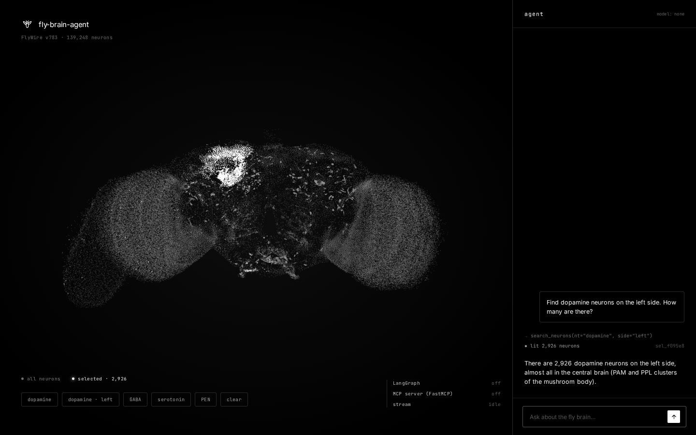

<p align="center">
  
</p>

# fly-brain-agent

/flaɪ breɪn ˈeɪ.dʒənt/
noun

1. an LLM agent that lets you talk to a whole fruit-fly brain, neuron by neuron.

[](LICENSE)

[](https://docs.astral.sh/uv/)
[](https://modelcontextprotocol.io)
[](https://langchain-ai.github.io/langgraph/)
[](https://flywire.ai)


**Ask a question in plain language. An agent searches 139,248 real neurons and answers.**

```text
$ uv run --env-file .env flybrain-chat --model google_genai:gemini-3.5-flash \
    "How many dopamine neurons are there, and in which super_class?"

There are 5,909 dopamine neurons:            (real run, answer trimmed)
  central 5,705 · sensory 129 · optic 26 · visual_centrifugal 21 · descending 12 · ...
```

The FlyWire project mapped every neuron of an adult fruit-fly brain. This repo turns that
atlas into **tools an LLM can use**: search neurons by type, neurotransmitter or side,
count them, describe one, page through results. The agent picks the tools, we run them,
and the answer comes back grounded in real data instead of the model's memory.

You choose the model. The same agent runs on Gemini, Claude, GPT or a local model, and the
same tools work from Claude Code or any other MCP client without changing a line.

## Highlights

- **The whole brain, not a toy.** FlyWire v783: 139,248 neurons with positions in µm,
  cell types and neurotransmitters.
- **Tools over MCP.** A standalone [Model Context Protocol](https://modelcontextprotocol.io)
  server. Plug it into Claude Code, our agent, or anything that speaks MCP.
- **Any model.** LangChain's `init_chat_model`: `--model google_genai:...`,
  `anthropic:...`, `openai:...`.
- **Selection tickets, not token floods.** A search that matches 86k neurons returns a
  short summary plus a ticket like `sel_3f9a2c` (about 1.3k characters instead of millions
  of tokens). Later tools act on the ticket.
- **A loop with a brake.** A hand-built LangGraph loop (no black-box `create_agent`) with
  a hard step limit, so a confused model can't spin forever.
- **Errors that teach.** Unknown tickets or tools come back as messages the model can read
  and fix itself, not stack traces.
- **Keys stay out of history.** Provider keys live in a gitignored `.env` loaded with
  `uv run --env-file`.

## Architecture

Dependencies point inward. The core knows nothing about MCP, the web or LLMs.

```text
frontend   Vite + Three.js         3D brain + chat                        (planned)
backend    FastAPI                 brain data + chat stream (SSE)         done
agent      LangGraph               any chat model, MCP client             done
tools      MCP server (FastMCP)    search, count, describe, page          done
core       flybrain.atlas          positions in µm, cell types, NTs       done
```

```text
 you ──► flybrain-chat ──► LLM (any provider)
                 │            │ "call count_neurons(nt=dopamine)"
                 ▼            ▼
           LangGraph loop ── MCP ──► flybrain MCP server ──► atlas (139k neurons)
                 ▲                                │
                 └──────── tool result ◄──────────┘   repeat until the model answers
```

## Quick start

```bash
git clone https://github.com/eJosR-Coding/fly-brain-agent.git
cd fly-brain-agent
uv sync
```

Download the FlyWire neuron annotations (see [Data](#data)) to
`data/raw/flywire_neuron_annotations.tsv`, then add a key:

```bash
cp .env.example .env && chmod 600 .env   # then put your key in .env
uv run --env-file .env flybrain-chat --model google_genai:gemini-3.5-flash "Find PEN neurons on the left side"
```

Options: `--model provider:model` (default `anthropic:claude-sonnet-5-5`, or set
`FLYBRAIN_MODEL`), `--max-steps N` (max tool rounds, default 6: `1` allows one tool round
plus the final answer). Other providers: `uv add langchain-openai`, then
`--model openai:<model>`.

### Choosing a model

The picker next to the message box lists the models from `GET /models`. Set any provider
keys you have in `.env` (see `.env.example`) and restart: the picker shows the catalog models
those keys can use, cheapest first, and the chat starts on the first one (or on `--model` /
`FLYBRAIN_MODEL` if you set it).

The built-in catalog (tool-calling models only): `deepseek:deepseek-flash`,
`deepseek:deepseek-v4-pro`, `groq:openai/gpt-oss-120b`, `groq:openai/gpt-oss-20b`,
`google_genai:gemini-3.5-flash`, `anthropic:claude-haiku-5-5`, `anthropic:claude-sonnet-5-5`.
OpenAI has no catalog entry yet; add one with `--models`.

At startup the server asks each provider that has a key for its model list (one request per
provider, 5 second timeout, key sent only to that provider in a header) and hides catalog ids
the provider no longer serves for your key. If that request fails, the model stays offered and
the row carries a `note`; a failed request never stops the server.

`--models` (or `FLYBRAIN_MODELS`) replaces the catalog with your own comma-separated
`provider:model` list; the same key and availability checks apply.

```bash
uv run --env-file .env flybrain-web --model google_genai:gemini-3.5-flash \
  --models google_genai:gemini-3.5-flash,groq:openai/gpt-oss-120b
```

A model is selectable only when its provider key is set: `GOOGLE_API_KEY` (`google_genai`),
`GROQ_API_KEY`, `DEEPSEEK_API_KEY`, `ANTHROPIC_API_KEY`, `OPENAI_API_KEY`. Models without a key
show as "(no key)" when you use `--models`. The server only accepts ids from this list, never
free text. The conversation keeps its history when you switch model between messages.

Free tiers have small quotas (Gemini's free tier allows about 20 requests per day per model,
and a tool-using turn makes several requests). When a model hits its quota the chat says so;
switch model in the picker or retry later.

## Tools (MCP)

| Tool | What it does |
|---|---|
| `search_neurons` | filter by cell_type / nt / super_class / side; returns a summary + `selection_id` |
| `count_neurons` | counts grouped by a field (top N + other) |
| `describe_neuron` | one neuron by root_id |
| `list_selection` | page through a ticket (default 20, max 25 per call; compact rows) |

Behavior worth knowing:

- Filters are trimmed; an empty or whitespace-only filter means "no filter". Values over 200
  characters are rejected. `side` is `left`, `right`, `center` or `na`.
- Out-of-range paging never errors: `offset`, `limit` (max 25) and `count_neurons` `top`
  (max 100) are clamped and the answer carries a `note` saying what changed
  (e.g. `limit capped to 25`, `offset 900 is past the end (total 42)`).
- A search with no match lists the valid values when `nt`, `super_class` or `side` is off.
- Tickets live in server memory, capped at 100 (`FLYBRAIN_MAX_SELECTIONS`), least recently
  used evicted first. An expired ticket says which search to run again.
- If the annotations file is bad or missing, the server prints one line to stderr and exits
  with code 1.

Run the server on its own (stdio): `uv run flybrain-mcp`. The annotations path comes from
`FLYBRAIN_ANNOTATIONS` (default `data/raw/flywire_neuron_annotations.tsv`).

Use it from Claude Code:

```bash
claude mcp add flybrain -- uv run --directory /path/to/fly-brain-agent flybrain-mcp
```

## Level 0: connectome structure

Four more tools answer structural questions with the real FlyWire wiring (no simulation).

```bash
# one-off build (~15 s, ~44 MB): sums synapses per neuron pair into data/processed/connectome_783.npz
uv run flybrain-build-connectome --source /path/to/proofread_connections_783.feather
```

The build maps root_ids to atlas rows, sums synapses across neuropils, drops pairs with ids
missing from the annotations and self-loops (it prints how many). Set `FLYBRAIN_CONNECTOME` to
use another path. The connectome is optional: without it the four tools reply "run
flybrain-build-connectome first" and everything else keeps working. `/health` reports
`connectome` and `connectome_edges`.

| Tool | What it does |
|---|---|
| `neighbors` | partners of a selection (`out`, `in` or `both`) with synapse totals, plus a ticket of all partners |
| `find_path` | strongest of the shortest directed paths between two selections: fewest hops, then the route whose weakest hop has the most synapses. Reports synapses per hop, the bottleneck (`min_hop_synapses`), `total_synapses`, how many equally short routes exist (`shortest_path_count`) and up to 3 `alternative_routes`, plus a ticket of the path neurons |
| `lesion_effect` | how many targets stay reachable from the sources once a selection is removed, plus a ticket of the lost ones |
| `top_hubs` | neurons with the most synapses (`in`, `out` or `total`), optionally filtered like `search_neurons` |

Example questions: "What do the dopamine PAM neurons project to?", "Is there a path from
photoreceptors (R1-6) to Kenyon cells?", "If I remove the PEN neurons, can the E-PG cells
still reach the PFL cells within 3 hops?", "Which Kenyon cells send the most synapses?".

Example `find_path` answer (R1-6 to descending neurons, real data, ~1 KB): 3 hops,
R1-6 -> L1 (36 synapses) -> L5 (131) -> DNc01 (11), bottleneck 11, 341 equally short routes, and
three alternatives such as `R1-6 > L2 > L5 > DNc01` (bottleneck 11). Strength is synapse count, a
proxy for connection weight; it says nothing about sign or efficacy.

Honesty note: everything here is structural. An edge means at least 5 synapses between a neuron
pair (the default threshold, which filters single-synapse segmentation noise; ~2.7M of 15M pairs
survive). A path is wiring that exists, not signal flow; sign (excitatory or inhibitory) and
dynamics are not used. The wiring is highly redundant, so single-group lesions often change
nothing structurally.

## Level 1: whole-brain simulation

"What does this group of neurons DO?" is answered by running activity through the real wiring.
`flybrain.simulation` is a seeded numpy re-implementation of the leaky integrate-and-fire model of
Shiu et al. (Nature 634, 2024; code: github.com/philshiu/Drosophila_brain_model, MIT). Stimulated
neurons get Poisson input; spikes travel through the signed connectome with a 1.8 ms delay.

```python
sim, cache_hit = Simulation.load_weights("Connectivity_783.parquet", "Completeness_783.csv", atlas, cache="sim_weights_783.npz")
res = sim.run(stim_rows, rate_hz=100, duration_ms=1000, trials=30, seed=0, silence_rows=None, bin_ms=10)
res.rate_hz                    # mean rate per neuron
res.active_rows, res.frames    # sparse time bins: only neurons that spiked, (n_active, n_bins) uint16, at most 200 bins
```

Setup: put the reference files `Connectivity_783.parquet` and `Completeness_783.csv` (commit
91bdd1e, MIT) in `data/raw/shiu/` (or point `FLYBRAIN_SIM_DATA` at the folder), then run
`uv run flybrain-build-sim-weights` once. It writes the signed CSR to
`data/processed/sim_weights_783.npz` (`FLYBRAIN_SIM_WEIGHTS` to change): loading takes 2.4 s
without the cache and 0.2 s with it (the first simulation in a process also needs ~1.5 GB of RAM;
the cache is rebuilt by itself when a source file changes). Without the files everything else keeps
working; the simulation tools answer with what to download.

It is checked step for step against the reference Brian2 model on tiny networks (unit tests) and on
the real connectome (`scripts/validate_against_reference.py`, never run by the test suite), stimulating
the 20 sugar-sensing neurons of the paper's example at 100 Hz for 1 s:

| Check | Reference (Brian2) | This simulator |
|---|---|---|
| MN9 mean rate | 61.7 Hz | 61.7 Hz (30 trials); 60.3 Hz in a 3-trial tool run |
| Neurons above 1 Hz | 341 | 342 |
| Pearson / Spearman of per-neuron rates | | 0.999 / 0.997 |
| Top-20 / top-100 responders shared | | 18 / 99 |

The remaining differences are stochastic: two runs of the same simulator differ by the same amount.
The full table and the semantics we matched are in `odd/tasks/simulation-level1.md`.

| Tool | What it does |
|---|---|
| `preset_selection` | a ticket for a published, cited neuron set: `sugar` (the 21 sugar-sensing GRNs of the paper's example, 20 exist in v783) or `mn9` (the proboscis motor neuron it reads out). The sets live in `src/flybrain/data/presets.json` with their source; an unknown name lists the available ones |
| `stimulate` | drives a selection and returns, in under 2 KB: how many neurons were active (above 1 Hz), the top 10 responders (`cell_type`, `super_class`, `rate_hz`), `top_non_sensory` (the 5 most active neurons that are not sensory: where silencing candidates come from), the rates of an optional readout group, a ticket of the active neurons (the viewer highlights it) and a `simulation_id` for the activity animation. Inputs are capped (rate 1 to 300 Hz, 100 to 1000 ms, 1 to 10 trials) and a `note` says when they were. With `silence_selection_id` those neurons still fire but pass nothing on; a baseline run is added to report the change in the readout (2x the runtime) |

One simulation runs at a time (a lock), in a thread, so the API stays responsive. Results are kept in
a small LRU (10). Real numbers on this machine: `stimulate(sugar, 100 Hz, 1000 ms, 3 trials,
readout mn9)` takes about 13 s including the first load, MN9 fires at about 60 Hz and the payload is
1.5 KB; silencing the top non-sensory responder (CB0248) doubles the work (26 s) and moves MN9 from
60.3 to 63.7 Hz, within the noise of a 3-trial run.

API: `GET /simulations/{id}` (meta) and `GET /simulations/{id}/frames` (`application/octet-stream`:
`n_rows` uint32 LE atlas rows, then `n_rows * n_bins` uint8 spike counts, row-major; 404 with a clear
message when unknown or expired), `GET /simulations/{id}/rows` (`[{row, cell_type, super_class}]` for
the recorded rows, or only the comma-separated `?rows=` among them), `POST /simulate` (the viewer's
no-LLM route: `{preset | selection_id, rate_hz, duration_ms, trials, readout_preset |
readout_selection_id, silence_preset | silence_selection_id}`; 422 on bad input, 404 for an unknown
ticket, 503 when the simulator is not set up), an `activity` SSE event (`simulation_id`, `n_bins`,
`bin_ms`, `compare_id`) after a `stimulate` result, and `simulation: true|false` in `/health`.

**Compare runs.** A run with silencing keeps BOTH recordings (same stimulus and seed): the silenced
one and the baseline. The silenced recording's meta (`GET /simulations/{id}`) carries `compare_id`
(the baseline's simulation id, also in the `activity` event), `silenced_rows` (up to 5,000) and
`readout` (`{label, neurons, rows, hz}`: the readout group's mean rate per time bin); the baseline's
meta has its own `readout` and `compare_id: null`. For example, no LLM needed:
`POST /simulate {"preset": "sugar", "readout_preset": "mn9", "silence_selection_id": "sel_..."}`.

In the viewer, the **give sugar** chip runs the paper's experiment (20 sugar neurons, 100 Hz, 1 s,
3 trials, MN9 read out) and plays the result as a wave of light over the brain, in slow motion,
with a timeline (play/pause, scrub, `t = 340 ms`) and the legend `activity · 336 neurons · MN9 60 Hz`.
Activity from a chat answer plays the same way. With reduced motion the summed activity is drawn
as a still frame.

The timeline has a mode toggle, and every mode is strictly black and white (shape, fill and size
carry the meaning, never hue):

- `wave`: the animation above.
- `latency`: a static map of when each neuron fired FIRST (first non-zero bin times the bin width).
  Early neurons are bright and larger, late ones dim grey, on a monotonic scale from 0 ms to the run
  length; a small black-to-white bar with ticks is the legend (`first spike · 0 ms → 1000 ms`).
- `diff` (only when the run has a baseline, see compare runs): per neuron, the rate in the silenced
  run minus the baseline rate (Hz). Neurons that LOST activity are hollow rings, neurons that GAINED
  are filled dots, the magnitude sets the size and brightness, unchanged neurons (under 0.5 Hz) are
  hidden, and the silenced neurons are marked with a grey cross. Legend:
  `diff · 36 lost · 263 gained · MN9 60 → 71 Hz`.

The `charts` chip opens a panel (bottom left, it replaces the color key while open) with two plain
SVG charts that share one time axis and a playhead synced with the wave:

- **raster**: spikes over time for the 30 busiest neurons, grouped by cell type (one bracket and
  label per group, never a label on every row); the readout group (MN9) is always included and drawn
  bold. Hover for the exact row, time window and spike count.
- **readout**: the readout group's mean rate over time on one y axis. In a compare run, baseline
  (solid) and silenced (dashed) are told apart by stroke style plus a legend and direct labels, never
  by color. The trace is a 25 ms moving average (a single neuron fires a few spikes per bin) and the
  tooltip shows the exact plotted values; the numbers are also in a visually hidden table.

Design notes (`dataviz` skill, adapted to the black and white palette): 2 px lines, hairline solid
grid, 12 px mono text at 9.8:1 contrast, one axis (no dual axes), legend only with two or more
series. The palette validator reports the lightness-band and chroma checks as expected failures
for an all-grey palette; the checks that matter here pass (contrast and separation between the two
greys), and identity never relies on tone: it comes from stroke style, shape and labels. No chart
library: two small SVGs do not justify the weight.

Honesty note: this is the published model of the wiring diagram with fixed parameters, not the
living fly: no neuromodulation, no plasticity, no ventral nerve cord, and the sign of each synapse
comes from the reference data. The agent is told to call results a model's prediction.

## Experiment bench (dose-response, silencing screen, statistics)

Two MCP tools turn single simulations into small experiments. Both are model predictions: the
trials of the simulator differ only by Poisson input noise, so every interval and p-value below
says how reproducible a result is inside the model, not how variable living flies are.

| Tool | What it does |
|---|---|
| `dose_response(selection_id, readout_selection_id, rates_hz=[10,25,50,100,200], duration_ms=300, trials=3)` | one simulation per rate (at most 8 rates, 1..300 Hz; duration 100..1000 ms; trials 1..10): readout mean Hz with a 95% CI (Student t over trials, lower bound clipped at 0 Hz), active neurons, and `ec50_hz`, the rate at half of the maximum response by linear interpolation (null, with a reason, when there is no response or it is already above half-max at the lowest rate) |
| `silencing_screen(selection_id, readout_selection_id, candidates="top_non_sensory", n=8, duration_ms=300, trials=3, rate_hz=100)` | one baseline, then each candidate neuron silenced in turn (same seeds): delta Hz with a 95% CI, Welch p, Holm-adjusted `p_adj` and `significant` (p_adj < 0.05). Candidates are the busiest non-sensory neurons of the baseline (never the stimulus or the readout), or any ticket; at most 12. Returns a `candidates_selection_id` ticket |
| `stimulate` | with `silence_selection_id`, trials default to 5 and the result gains `readout_stats`: baseline vs silenced as mean and 95% CI, delta, Welch p, Cohen's d and a plain verdict |

Statistics (`src/flybrain/stats.py`): sample SD, t interval, Welch's t-test, Cohen's d (pooled SD)
and the Holm correction, checked against textbook values. A run with one trial reports no interval
and no p-value ("need at least 2 trials"); groups without any spread are handled explicitly (equal
means give p = 1, different means p = 0, never NaN). The verdict says "significant at p<0.05" or
"not distinguishable from noise with N trials", and names the correction when several candidates
are tested. Silencing zeroes a neuron's outgoing synapses; the same random seeds are used for the
baseline and the silenced runs, which makes the Welch test conservative rather than lenient.

Everything runs under the simulator's single lock (one simulation at a time) and holds the lock for
the whole experiment. Each silenced run is kept as a recording linked to the shared baseline (a
baseline is never evicted while a run compared against it is alive), so the viewer can open the
difference map of any screen row. Progress (`experiment`, `done`, `total`) is streamed as SSE
`progress` events during a chat turn and exposed by `GET /experiments/progress`; the finished
chart arrives as a `chart` event (`{kind: "dose_response" | "screen", id, ...}`).

No-LLM endpoints for the viewer chips: `POST /experiments/dose_response` and
`POST /experiments/screen` (stimulus and readout as a preset or a ticket, like `POST /simulate`);
the answer is the tool result plus its `chart` payload.

Measured on the real data on this machine (sugar-sensing neurons -> MN9 readout, 300 ms, 3 trials):
one run costs about 1.3 s per trial at 100 Hz, so the default dose-response (5 rates) took
19.0 s and the default screen (baseline + 8 candidates) 37.1 s. That fits the 90 s turn limit with
room to spare, but a turn that also waits on a slow model may not, so experiment tools extend the
turn deadline by `FLYBRAIN_EXPERIMENT_TIMEOUT` seconds (default 300) each time the model starts one;
other tools get no extra time.

Real example (screen, 3 trials, 100 Hz): baseline MN9 63.3 Hz (95% CI 41.4 to 85.2). Silencing the
eight busiest non-sensory neurons moved MN9 by between -12 and +19 Hz, and none of them was
significant after Holm correction (smallest raw p = 0.045 for DNge031, adjusted 0.36): with this
trial-to-trial spread, 3 trials cannot resolve effects that small. The dose-response gave no MN9
response at 10 and 25 Hz, 17.8 Hz at 50, 63.3 at 100 and 85.6 at 200 Hz (half-max about 77.5 Hz,
and the curve is still rising at the top of the sweep).

The viewer has two chips, `dose` and `screen` (sugar neurons -> MN9, disabled when the simulator is
unavailable, with live `screen · 3/8` progress). Their charts open in the charts panel: the
dose-response curve (log x axis, mean line with CI band and whiskers, a dashed EC50 marker with a
direct label, tooltips with the exact values) and the screen (ranked dots with CI whiskers around a
zero line; filled dot = significant after correction, hollow = not, so nothing relies on colour;
clicking or pressing Enter on a row opens that candidate's difference map). Both have a visually
hidden data table. The tool definitions sent on every model call grew by about 540 tokens for the
two tools (budget test: 8,400 characters).

## How the agent works

`flybrain.agent` is an explicit LangGraph loop: the model node asks, `ToolNode` executes,
and we repeat until the model answers without tool calls. `ask()` caps the tool rounds
(`--max-steps`) and returns `[hard stop] reached N tool rounds without a final answer`
instead of crashing. A malformed tool call goes back to the model so it can retry, an empty
reply is reported as `[no answer] ...`, and if the MCP server dies mid-run the run stops with
`the flybrain server stopped: <cause>` rather than letting the model improvise.

The agent is an MCP client: `flybrain.agent_mcp` launches the server over stdio and keeps
**one session per conversation**. That matters: tickets live in the server process, and the
adapter's default `get_tools()` opens a new session (a fresh server) per tool call, which
would lose them. A test pins this behavior.

### Token budget

Every model call sends the system prompt (~230 tokens), the 10 tool definitions and the
conversation. Free tiers (Groq) limit tokens per minute, so the agent keeps all three small:

- **Tool definitions** are compact: about 6.5k characters (~1.6k tokens) in total, down from
  12.3k. A test pins the budget (`TOOL_DEFS_BUDGET_CHARS` in `tests/test_mcp_server.py`), so
  descriptions cannot creep back. Shared caveats (structural, not signal flow; a model, not the
  living fly) live once in the system prompt.
- **History sent to the model** is compacted by `compact_history`. The checkpointed thread
  keeps everything; the model only sees the last `FLYBRAIN_KEEP_TURNS` user turns in full
  (default 3, an integer >= 1; the current turn is always whole). Older turns shrink to the
  question and the final answer: their tool calls and results are dropped together, so no tool
  call is left without its result. In the kept window a single tool result over 4,000 characters
  is cut with a `... [truncated N chars]` marker.
- **Per-request budget.** After compaction, `fit_to_budget` makes the whole request (system
  prompt + tool definitions + messages, estimated as characters / 4) fit
  `FLYBRAIN_CONTEXT_BUDGET` tokens (default 6000, an integer >= 1000). It drops the oldest
  whole turns first (never the current one), then cuts the largest tool results of the
  current turn down to 1,000 characters each. Why: on 2026-11-10 the Groq headers for
  `openai/gpt-oss-120b` and `openai/gpt-oss-20b` on the free tier showed
  `x-ratelimit-limit-tokens: 8000` per minute, and a single request above that fails with
  HTTP 413 ("Request too large"). The estimate is rough (id-heavy JSON tokenizes denser than
  4 chars per token), so on that tier set `FLYBRAIN_CONTEXT_BUDGET=4000` if you still see 413s.
  A 413 is reported as "request too large for its per-minute token limit; start a new chat or
  ask a narrower question", distinct from the 429 quota message.
- **New chat.** The chat header has a `new chat` button that clears the log and drops the
  conversation id, so the next message starts a fresh thread (and a fresh token count).
  `list_selection` pages are small by design (default 20, max 25 rows of
  `root_id, cell_type, super_class, side`).
- **Fail fast on rate limits.** Chat models are built with `max_retries=1`, so a 429 reaches the
  friendly quota message in seconds instead of the SDK retrying silently until the turn limit.
- **Usage per turn.** The server sums `usage_metadata` over every model call of the turn and
  sends `usage` `{calls, input_tokens, output_tokens, total_tokens}` just before `answer`
  (fields are `null` when the provider reports none). The web UI shows a dim line under the
  answer, e.g. `4 calls · 18.2k tokens (15.9k in · 2.3k out)`, or `usage unavailable`.

## Core (no LLM needed)

```python
from flybrain.atlas import load_atlas

atlas = load_atlas("data/raw/flywire_neuron_annotations.tsv")
atlas.find(cell_type="PEN", side="left", limit=5)  # prefix match, filters are AND-ed
atlas.count_by("top_nt", super_class="central")    # {"acetylcholine": ..., "unknown": ...}
atlas.describe(720575940628857210)                  # one neuron as a plain dict (µm)
```

## Web API

A FastAPI backend for a browser viewer. It loads the atlas once, hosts the MCP server
in-process (in-memory session, so the agent still only talks to tools over MCP) and shares
the same selection store, which lets it turn a ticket into row indices for highlighting.

```bash
uv run --env-file .env flybrain-web --model google_genai:gemini-3.5-flash   # 127.0.0.1:8000
```

Options: `--host`, `--port`, `--model` (or `FLYBRAIN_MODEL`), `--models` (or `FLYBRAIN_MODELS`),
`--max-steps`. CORS allows
`http://localhost:5173` (Vite) by default; set `FLYBRAIN_CORS_ORIGINS` to a comma-separated
list to change it. `--help` needs no model or key.

Each chat turn has a time limit (`FLYBRAIN_TURN_TIMEOUT`, default 90 s). Provider SDKs can
retry overload errors (HTTP 503) with backoff for minutes; when the limit hits, the stream
sends an `error` event and then `done` instead of going silent. A cut turn (limit, hard stop,
model error) leaves the conversation usable: tool calls it never answered are closed with a
"cancelled" tool result, so the next message on the same `conversation_id` works. The value
must be a positive number; anything else stops startup with a one-line error.

| Endpoint | What it returns |
|---|---|
| `GET /health` | `{"status": "ok", "neurons": N, ..., "simulation": true\|false}` |
| `GET /brain/meta` | the binary contract below, as JSON |
| `GET /brain/points` | all positions, `application/octet-stream` (~1.67 MB) |
| `GET /brain/regions` | one `uint8` per neuron, same row order as `/brain/points`; the code table is `regions` in `/brain/meta` (`0` central, `1` optic, `2` sensory, `3` other), derived from `super_class` |
| `GET /brain/nt` | one `uint8` per neuron, same row order: the predicted top neurotransmitter (`nt` table in `/brain/meta`: `0` acetylcholine, `1` glutamate, `2` gaba, `3` dopamine, `4` serotonin, `5` octopamine, `6` unknown) |
| `GET /brain/landmarks` | JSON computed from the data: centroids in micrometers (`central brain`, `optic lobe L/R`, `lamina L/R`), plus per side the lobe center, a robust lobe radius (80th percentile) and the outward lamina direction |
| `GET /models` | `{"default", "models": [{"id", "provider", "available", "reason"?, "note"?}]}`: the model picker's registry |
| `POST /chat` | `text/event-stream`, body `{"message", "conversation_id"?, "model"?}`; `model` must be an available id from `/models`, else `422` listing them |
| `GET /neurons/{row}` | one neuron by atlas row (the index the viewer uses): `root_id` (a string, it does not fit a JS number), `cell_type`, `cell_class`, `super_class`, `side`, `top_nt`, `position_um`, `region`, and with a connectome `partners: true` plus the top 5 `inputs` and `outputs` (`{row, cell_type, super_class, synapses}`) and `synapses_in` / `synapses_out` totals (`partners: false` and no lists without one); `404` for a row outside the atlas, `422` for a non-integer |
| `GET /selections/{id}/indices` | row indices of a ticket, uint32 LE; 404 if unknown or expired |

**Chat stream events** (`POST /chat`): `meta` `{conversation_id, model}`, `tool_call`
`{id, tool, args}` (the tool started), `tool_result` `{id, tool, ok, ms}` (it finished, `ms`
since its `tool_call`), `highlight` and `activity` as before, `path` `{selection_id, rows, synapses,
bottleneck}` (after a successful `find_path`: the route as atlas rows in order, one synapse count
per hop, and the weakest hop; omitted when the route has a neuron the atlas does not know), `answer_delta` `{text}` (final
answer chunks, only from models that stream; a client drops any partial text when the next
`tool_call` arrives), then `usage` `{calls, input_tokens, output_tokens, total_tokens}` (token
counts of the turn, `null` when the provider reports none; sent before `answer`/`error` when the
model was called), `answer` `{text}` with the full text, `error` `{message}`, `done`. Experiments add `progress` `{experiment, done, total}` (between an experiment tool's `tool_call` and `tool_result`) and `chart` `{kind, id, ...}` (after its result).

**Binary contract.** `/brain/points` is `count * 12` bytes: float32, little-endian, `x y z`
interleaved, in micrometers, in atlas row order. Decode with
`new Float32Array(buffer)` in the browser or `np.frombuffer(body, "<f4").reshape(-1, 3)`.
A highlight is a list of row indices into that same array (the browser never sees root_ids).

**Chat stream.** `message` is trimmed and must be 1 to 2000 characters (else 422).
Send the same `conversation_id` to keep multi-turn memory (the server makes one if you
omit it). Events, in order:

| Event | Data |
|---|---|
| `meta` | `{conversation_id}` (always first) |
| `tool_call` | `{tool, args}` (long argument values are truncated) |
| `highlight` | `{selection_id, total, indices}`; above 5000 neurons `indices` is `null` and `fetch` gives the URL to download them as binary |
| `answer` | `{text}` |
| `error` | `{message}` (model failure, server stopped, hard stop) |
| `done` | `{}` (always last, so a stream never hangs) |

```text
event: meta
data: {"conversation_id": "9f1c..."}

event: tool_call
data: {"tool": "search_neurons", "args": {"nt": "glutamate"}}

event: highlight
data: {"selection_id": "sel_3f9a2c", "total": 1, "indices": [60]}

event: answer
data: {"text": "One glutamate neuron."}

event: done
data: {}
```

## Viewer



<sub>Real data and real highlight (5,909 dopamine neurons from the backend, shown in `regions` mode). Nothing is drawn that is not in the data; the chat panel is empty because this capture ran the backend without a model.</sub>

A Vite + TypeScript + three.js app in `web/`: all 139,248 neurons as one point cloud (loaded
from the binary `/brain/points` contract, orbit with the mouse) and a chat panel on the right.

```bash
# terminal 1: backend (drop --model for search-only: chips work, chat reports "no model")
uv run --env-file .env flybrain-web --model google_genai:gemini-3.5-flash

# terminal 2: viewer (the dev server proxies /api to 127.0.0.1:8000)
pnpm -C web install && pnpm -C web dev      # open http://localhost:5173
```

The look follows a Penpot design: Inter and JetBrains Mono are self-hosted (`@fontsource`, no CDN),
every color, size and spacing is a custom property in `web/src/style.css`, and selected neurons are
drawn on their own larger, additive layer so they stand out against the dim base cloud. The status
block is real: `GET /health` reports `chat` and `model`, and `stream` is live while a turn runs.

Without a model, run the data and search endpoints only with
`uv run uvicorn --factory flybrain.api:create_app --port 8000`.

- **Chips** (dopamine, dopamine · left, GABA, serotonin, PEN, clear) call
  `GET /neurons/search`, which uses the same search tool and ticket store as the agent but no
  LLM, so they keep working when the model provider is down.
- **Highlights**: when the agent finds neurons, the stream sends a `highlight` event with row
  indices (or a URL to fetch them as binary when the set is large); those points turn white
  and everything else stays grey. `clear` restores the base colors.
- **Click to inspect**: hover a neuron and it gets a ring; click it (a press that moves more than a
  few pixels is an orbit drag, not a click) and a neuron card opens next to it, fed by
  `GET /neurons/{row}`: type, class, side, transmitter, position, region, synapse totals and the top
  5 input and output partners. `show partners` lights the neuron and those partners; `Esc`, `x` or a
  click on empty space closes it. The card is focusable and built with `textContent` only. Picking is
  a raycast on the point cloud with a tolerance of a few screen pixels, taking the hit nearest the
  pointer ray; the selection, click-vs-drag, card model and card placement are pure, tested
  functions (`web/src/inspect.ts`).
- **Paths as cables**: when the agent runs `find_path`, the `path` event draws the route as
  fine white threads between the neurons it passes through (`web/src/pathLayer.ts`). Thread width
  grows subtly with the log of the hop's synapses (1 px to 2.5 px), each hop is labelled (`19 syn`, hidden on
  small screens), and lights travel from source to target (static under `prefers-reduced-motion`).
  The legend reads `path · 3 hops · bottleneck 5 syn`. The `clear` chip, a new selection or `new
  chat` removes them.
- **Look**: all styling lives in `web/src/style.css` as custom properties (colors, fonts, panel
  width, point size and opacity, highlight color); the three.js parameters are read from them
  in `web/src/theme.ts`.
- **Anatomy context**: real data never moves and nothing is drawn that is not in the data. Two color
  modes (chips `regions` / `transmitters`), each with a compact key listing real neuron counts:
  - `regions` (`/brain/regions`): central brightest, optic mid grey, sensory cooler, other dim.
  - `transmitters` (`/brain/nt`, predicted top neurotransmitter): strictly grey tiers, so the rare
    and interesting ones stand out (dopamine and serotonin brightest and a bit larger, then
    octopamine, GABA, glutamate, acetylcholine, unknown darkest).
  The highlight layer stays dominant in both. Tones and the depth cue are custom properties.
- **Labels**: `central brain`, `optic lobe` and `lamina · eye input` are anchored to centroids
  computed from the data (`/brain/landmarks`). Each label is pushed outside the cloud's projected
  silhouette, on the screen side of its landmark, with a hairline leader; the placement is a pure,
  unit-tested function.
- **Motion and depth**: a slow auto-orbit (chip `orbit`, on by default, off under
  `prefers-reduced-motion`) pauses while you drag and for a few seconds after. Points nearer the
  camera are slightly brighter and larger, far ones dimmer (vertex shader, no extra passes). The
  `front` and `3/4` chips reset the camera.
- **Rich answers**: the chat renders headings, lists (3 levels), task lists, GFM tables (alignment,
  escaped pipes, cross tables with row headers, 200 x 20 cap, horizontal scroll), fenced and
  indented code, blockquotes, rules, strikethrough and math (`$x$`, `\(x\)`, `$$x$$`, `\[x\]`).
  Half-streamed constructs (an open fence, `$$` or table) stay plain text until they close.
- **Security model**: model output is untrusted. `web/src/markdown.ts` parses to an AST and builds
  DOM with `createElement` and text nodes only: no `innerHTML`, links and images are shown as text,
  HTML in the answer is literal, alignment and layout come from fixed classes (never inline
  styles), the code-block language label is a plain-text span restricted to a short alphanumeric
  whitelist, and input is capped (20k chars, 2k per formula, 150 formulas, no regex backtracking).
  Math is the only parsed-HTML path: KaTeX (`trust: false`, MathML output, `maxExpand`/`maxSize`
  bounded) is passed through DOMPurify with a strict allow-list and inserted as a fragment; if
  anything fails the source is shown as text. `$5 and $10` is not math (no space after the opening
  `$`, none before the closing `$`, not followed by a digit, first `$` decides). A hostile-input
  corpus (script/img/svg/iframe, `javascript:` and `data:` URLs, `\href`, `\style`, `\htmlData`,
  200k inputs) is tested with jsdom.
- **Tool trace**: every tool, highlight, path, activity and chart line of a turn sits in one disclosure above the answer, collapsed by default (`Used 3 tools · 14.2 s`, `3 tools · 1 failed`, live `running screen · 3/8 · 6 s`). The open/closed choice is remembered in `localStorage` (the app works without it); the transition is skipped under `prefers-reduced-motion`.
- Tests: `pnpm -C web test` (SSE parser, region and transmitter tones, label placement, neuron picking and card model, path validation and cable geometry, orbit gate, binary decoding, chat stream, markdown parser and security corpus).

## Roadmap

- [x] Atlas core: positions, types, neurotransmitters
- [x] MCP server with selection tickets
- [x] LangGraph agent + `flybrain-chat` CLI, tested end to end with Gemini
- [x] FastAPI backend: binary brain points + streamed chat (`flybrain-web`)
- [x] Three.js viewer: the brain in 3D, neurons light up as the agent works (`web/`)
- [x] Level 0: structural connectome tools (neighbors, paths, lesions, hubs)
- [ ] Tools that change the brain: lesion a selection, scale a neurotransmitter's gain
- [x] Level 1: whole-brain LIF simulation validated against the reference, `stimulate` tool, activity wave in the viewer

## Data

Not included in this repo. Place the FlyWire neuron annotations (Schlegel et al. 2024,
materialization v783) at:

```text
data/raw/flywire_neuron_annotations.tsv
```

Source: <https://github.com/flyconnectome/flywire_annotations>. The data belongs to the
FlyWire consortium and its authors; follow their terms and cite their papers if you use it.

## Development

```bash
uv sync
uv run pytest        # 579 tests, no network or API key needed (fake chat model)
```

Work is tracked per feature in [`odd/tasks/`](odd/tasks/), with test-first commits.

## License

Code: [MIT](LICENSE). FlyWire data is not covered by this license (see [Data](#data)).
