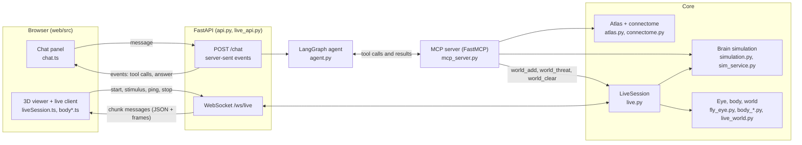
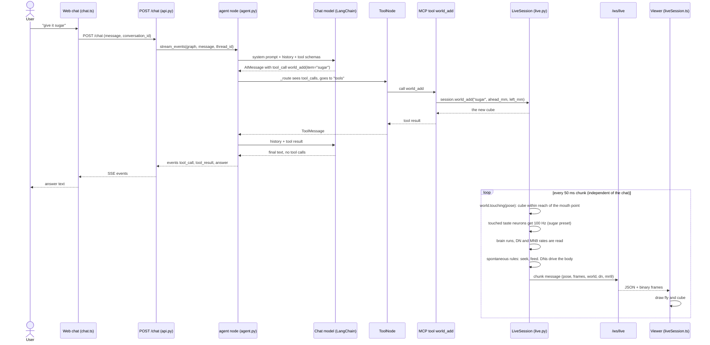
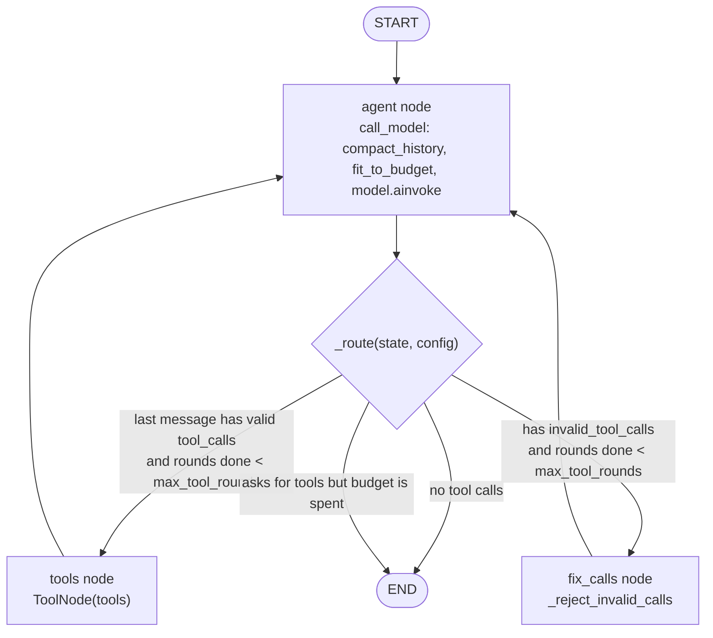
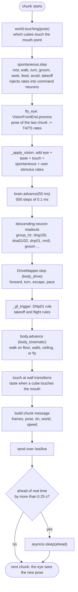

# Architecture

This page explains how the project fits together. It is written for someone who is learning it.
Each diagram follows the real code, and the file or function names are given so you can open them.

## 0. What it is

fly-brain-agent lets you talk to a model of the fruit-fly brain. You chat in the browser, a language model
picks tools, and the tools search the connectome or run a live simulation where a simulated fly walks, eats and flies
inside a glass cube.

## 1. Big picture

Key facts:

- The chat goes over **SSE** (server-sent events): the browser POSTs `/chat` and reads the event stream.
- The live view goes over a **WebSocket** (`/ws/live`): the server pushes one message per 50 ms chunk.
- The MCP server runs **inside the API process** (`create_connected_server_and_client_session` in `api.py`).
  Its world tools reach the running live session through `app.state.live_session`.
  `flybrain-mcp` (`mcp_server.main`) also runs it on its own for other clients.
- Only one live session runs at a time (`app.state.live_lock`).
- Dependencies point inward: the core does not know about MCP, the web or LLMs.

## 2. Walkthrough 1: "give it sugar"

What happens after the cube lands (all of it is in `LiveSession._step_locked`):

1. If a sugar cube is within 40 mm (`SMELL_RADIUS_MM`), the spontaneous scheduler enters `seek` and injects turn and walk rates into DNa02 and DNg100. This is our rule.
2. The body walks to the cube. When the mouth point is within 1 mm of the cube surface, the world reports `touching`.
3. The touched cube drives the sweet taste neurons at 100 Hz (`live_world.TASTE_HZ`).
4. The brain answers. MN9 is reported as a readout. The scheduler enters `feed` and the body stands still for 5 to 15 s (our rule).
5. The cube is used up over the meal (`World.consume`, `MEAL_MS`) and disappears.

## 3. The agent inside (the LLM part)

The loop in `build_graph` (`agent.py`) is built by hand from LangGraph parts.

The router is `_route`. It checks `tool_calls` first, then `invalid_tool_calls`. If the model asks for yet another round after
`max_tool_rounds` rounds in the current turn, the router returns END, and the caller reports a hard stop.

### The brakes

| Brake | Where | What it does |
|---|---|---|
| Max rounds | `ask` / `stream_events`, `MAX_STEPS = 6` | A round is one agent-then-tools trip. Past the budget the run ends with `[hard stop] reached N tool rounds without a final answer`. |
| Recursion limit | `recursion_limit = 2 * max_steps + 2` | A backstop under the router. A `GraphRecursionError` becomes the same hard stop. |
| Truncated tool results | `compact_history`, `MAX_TOOL_CHARS = 4000` | The model sees at most 4000 characters of each tool result. Older turns shrink to question + answer. The stored thread is never changed. |
| Token budget | `fit_to_budget`, `DEFAULT_CONTEXT_BUDGET = 6000` | Drops the oldest turns first, then cuts the biggest tool results (not below 1000 characters). |
| Bad tool calls | `fix_calls` node | Each malformed call gets an error `ToolMessage`, so the model can try again. |
| Tool errors | `_tool_error_handler` | A normal tool error goes back to the model as text. |
| Dead MCP server | `server_gone`, `ServerStoppedError` | The run stops. The model must not improvise without tools. `api.py` then marks `tools_ok = False`. |
| Empty reply | `NO_ANSWER` | An empty final reply becomes `[no answer] the model returned an empty reply`. |
| Turn timeout | `stream_events(turn_timeout)`, `TURN_TIMEOUT_S = 90` | Slow providers end the turn with an error. Long experiment tools get extra time. |
| Cut turns | `close_dangling_tool_calls` | A tool call that never got a result is closed with an error message, so the thread stays valid. |
| Memory | `InMemorySaver` checkpointer, `thread_id` = conversation id | Each conversation keeps its history. All models share one checkpointer, so you can switch model mid-chat. One turn at a time per conversation. |

### Who does what

| Piece | Job here |
|---|---|
| LangChain | Chat model adapters (`init_chat_model`, listed in `models.py`), message types, tool schemas (`bind_tools`). |
| LangGraph | The loop itself: `StateGraph`, nodes, conditional edges, state (`MessagesState`), checkpointing, streaming. |
| MCP | The tool contract. `mcp_server.py` exposes the tools. `load_mcp_tools` turns them into LangChain tools. |

### Why the loop is hand-built

We do not use `create_react_agent`. Writing the loop ourselves lets us put in the things above: a round budget counted per
turn, a path for malformed calls, a context window that never changes the stored thread, and a stop when the tool server dies.
Each of these is a small, testable function.

## 4. Walkthrough 2: the live loop every 50 ms

`LiveSession._step_locked` runs one chunk of 50 ms of simulated time. `live_api._stream` calls it again and again.

Notes:

- **Latency.** The eye sees the pose of the chunk that just ended. Its rates drive the next chunk, so vision lags by 50 ms.
- **Brain step.** 50 ms at `dt = 0.1 ms` is 500 steps (`simulation.py`, leaky integrate-and-fire neurons).
- **Pacing.** The session runs as fast as the computer allows and reports its real speed (`speed_factor`, for example "x0.24 real time").
  It does not slow down to look real. The only brake is `LEAD_S = 0.25 s` in `live_api._stream`: a session that runs faster than
  real time waits, so the viewer's buffer is not flooded. A slow session is never padded.
- **Viewer.** `liveSession.ts` and `livePlayback.ts` play the chunks back on their own time base. The viewer never shows more speed than the server measured.
- **Walls and flight.** The kinematic body walks on the floor, the four walls and the ceiling (`body_surface.py`) and can take off (`takeoff`).
- **GPU or CPU.** A GPU brain moves to the CPU for the rest of the session if it gets too hot or fails (`_advance_brain`). Every message says so.

## 5. What comes from the brain and what is our rule

The brain is the FlyWire connectome run as a leaky integrate-and-fire model. Everything else that turns spikes into
behavior is a choice we made. The code labels these as "ours, not validated".

| Behavior | From the brain (connectome model) | Our rule (labelled in code) |
|---|---|---|
| Loom escape | The looming dark ball drives the eye's T4/T5 cells, and DNp01 (the giant fiber) fires | The eye front end (Reichardt correlators, photoreceptors bypassed), the takeoff trigger `GF_RULE_NOTE`: DNp01 > 0 Hz in at least 2 of the last 3 chunks |
| Sugar | Sweet taste neurons drive MN9 (proboscis) | Cube contact within 1 mm, taste rate 100 Hz (`live_world`), stand still 5 to 15 s while feeding, meal length `MEAL_MS` = 8 s, then the cube disappears |
| Bitter (coffee) | Bitter taste neurons suppress feeding circuits | Avoid within 10 mm, pause 1 s after contact, then walk away |
| Walking on the floor | Optic flow (T4/T5) and DNg100 drive forward walking | DN to body mapping (`body_drive`: thresholds, gains, smoothing) |
| Touch | Antennal and leg touch inputs drive the turning DNs (DNa01, DNa02) | The touch rate (25 Hz), its 100 ms duration, which cells get it |
| Seeking sugar | The brain turns and walks when DNa02 and DNg100 fire | Smell radius 40 mm, the bearing gain, "turn first, then walk" at 25 degrees |
| Spontaneous behavior | None: the model is silent without input | The ethogram (`spontaneous.py`): states, durations, transition odds, injected rates |
| Wall and ceiling walking | None | Adhesive pad rule in `body_surface.py` |
| Flight path and saccades | The flight DNs are silent in this model | Recorded flight clips replayed slower, wall-evasion saccades, bout length, landing rule (DNp07 + DNp10) |
| Wing display | None | The recorded wingbeat is shown at 10 Hz in simulated time and drawn at 8 Hz on screen (`WING_FLAP_HZ`) so you can see it |
| Grooming | The anterior-grooming DNs (DNg10/11/12) fire | Groom on at 8 Hz, off at 3 Hz (hysteresis) |

Rule of thumb: if a line in `live.py`, `spontaneous.py` or `live_world.py` says "ours" or "not validated", it is a rule we added.

## 6. File map

| Path | Job |
|---|---|
| `src/flybrain/atlas.py`, `connectome.py`, `connectome_build.py` | Neuron table (positions, cell types, transmitters) and the synapse graph |
| `src/flybrain/tools.py`, `selections.py` | Plain tool logic and selection tickets |
| `src/flybrain/mcp_server.py` | MCP tools, including `world_add`, `world_threat`, `world_clear` |
| `src/flybrain/agent.py`, `agent_mcp.py` | The hand-built LangGraph loop and MCP client helpers |
| `src/flybrain/models.py` | Model registry and provider checks for the picker |
| `src/flybrain/api.py` | FastAPI app: brain data, `/chat` (SSE), models, experiments |
| `src/flybrain/live_api.py` | `/ws/live` WebSocket: one session, commands, pacing, idle timeout |
| `src/flybrain/live.py` | `LiveSession`: one 50 ms chunk, eye to body |
| `src/flybrain/live_world.py` | Cubes, threats, contact and taste |
| `src/flybrain/spontaneous.py` | The behavior state machine (ethogram, seek, feed, avoid) |
| `src/flybrain/fly_eye.py`, `retina.py`, `motion.py` | Eye model: columns, Reichardt motion detectors, T4/T5 rates |
| `src/flybrain/simulation.py`, `gpu_simulation.py`, `sim_service.py` | Leaky integrate-and-fire brain (CPU, GPU) and its service |
| `src/flybrain/body_drive.py`, `body_readouts.py` | DN readouts and our DN to walking-drive mapping |
| `src/flybrain/body_kinematic.py`, `body_surface.py`, `body_groom.py` | Kinematic body, surface walking, grooming and head |
| `src/flybrain/body_runner.py`, `body_service.py` | Physics body (NeuroMechFly) for recorded clips |
| `scripts/` | Build the connectome, body, motion and flight libraries |
| `web/src/chat.ts`, `sse.ts`, `turn.ts` | Chat client and SSE parser |
| `web/src/liveClient.ts`, `liveSession.ts`, `livePlayback.ts`, `liveFrames.ts` | Live client, playback buffer, message parsing |
| `web/src/body*.ts` | Fly rig, pose, cube, world and animation |
| `web/src/scene.ts`, `stage.ts`, `main.ts` | 3D brain scene and app wiring |
| `tests/` | Python tests; `web/` has the front-end tests |

## 7. Glossary

- **DN (descending neuron)**: a neuron that carries commands from the brain down to the body.
- **Giant fiber (DNp01)**: the DN pair that triggers the fast escape jump. In our model a looming dark object makes it fire.
- **MN9**: a motor neuron that extends the proboscis, the fly's mouth part. It is our sugar readout.
- **T4/T5**: the motion-detecting cells of the eye. They are the input we give the brain from vision.
- **LIF (leaky integrate-and-fire)**: a simple neuron model. It adds up input, leaks over time and spikes at a threshold.
- **Chunk**: one 50 ms step of the live loop and the message the server sends for it.
- **MCP (Model Context Protocol)**: a standard way to offer tools to a language model.
- **SSE (server-sent events)**: a one-way stream from server to browser over HTTP. The chat uses it.
